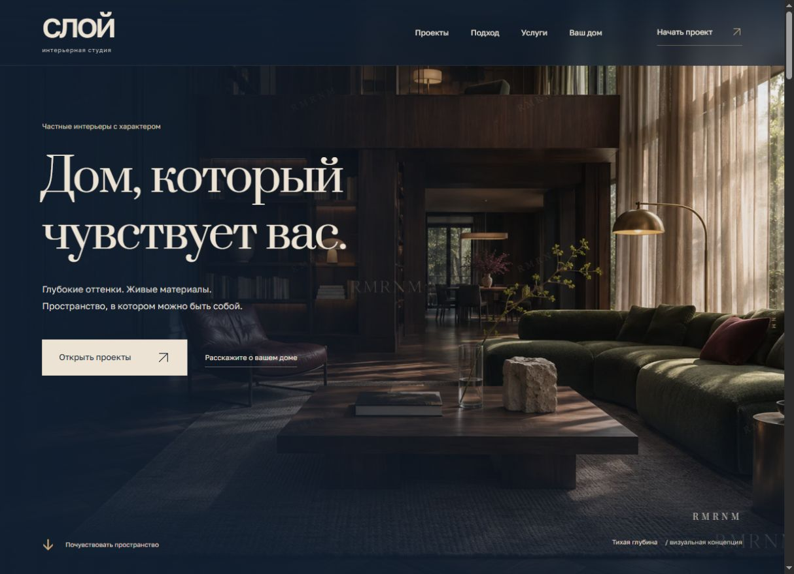

# Слой · интерьерная студия · RMRNM

Одностраничный сайт для портфолио: глубокий синий, бордовый, лесная зелень, тёмный орех и тёплый свет.



Сайт: https://rmrv-n.github.io/sloy-rmrnm/

## Содержание и действия

- Крупная интерьерная фотография на главном экране, понятная навигация по якорям.
- Три авторские визуальные концепции; фильтр по квартирам и домам, галерея со стрелками и клавиатурным управлением.
- Три интерактивные палитры с фотографиями и описаниями материалов; выбор переносится в бриф.
- Услуги с раскрывающимся составом, этапы проекта, материалы и ответы на вопросы.
- Конструктор брифа: тип пространства, площадь, формат, настроение, пожелания; иллюстрационный расчёт.
- Локальное формирование брифа, кнопки скачивания TXT и копирования. Данные не отправляются, контакты не запрашиваются.
- Адаптивная вёрстка, локальные кириллические шрифты, оптимизированные WebP, поддержка reduced motion, модальные окна с Escape.

Студия, площади и тарифы демонстрационные. Изображения созданы встроенным imagegen и не показывают реализованные объекты. Нет выдуманных клиентов, отзывов, наград и статистики.

## Запуск

Node.js 20+; установка зависимостей не нужна.

```sh
node serve.mjs
```

Открыть http://127.0.0.1:4175 . Готовый сайт — `dist/index.html`; его можно открыть и как локальный файл.

Проверка:

```sh
node --check dist/assets/app.js
node verify.mjs
```

## Файлы

- `dist/index.html` — единственная страница, контент и модальные окна.
- `dist/assets/style.css` — оформление, адаптивные размеры.
- `dist/assets/app.js` — галерея, палитры и бриф.
- `dist/assets/*.webp` — фотографии со встроенной маркировкой RMRNM.
- `notes/design.md` — дизайн-концепция и ссылки на изученные сайты и UX-источники.
- `notes/image-prompts.md` — промпты встроенного imagegen и пути всех визуалов.
- `notes/verification.md` — результаты проверки и ограничения.

GitHub Pages публикует `dist/` через `.github/workflows/pages.yml`. Источник в Settings → Pages: GitHub Actions. Публикация обновляется при push в main.

## Авторство

© 2026 RMRNM. Авторские права на дизайн, код, тексты и визуальные материалы сохранены. Публичный репозиторий не предоставляет лицензию на перепубликацию.

Маркировка RMRNM встроена в фотографии, паттерн, оформление и метаданные. Абсолютно неудаляемой маркировки веб-сайта не существует. Выделение текста и контекстное меню работают.

Шрифты Prata и Golos Text лицензированы отдельно по SIL Open Font License. Уведомления в `dist/assets/licenses/`. Для работы сайта повторно скачивать шрифты не требуется.
